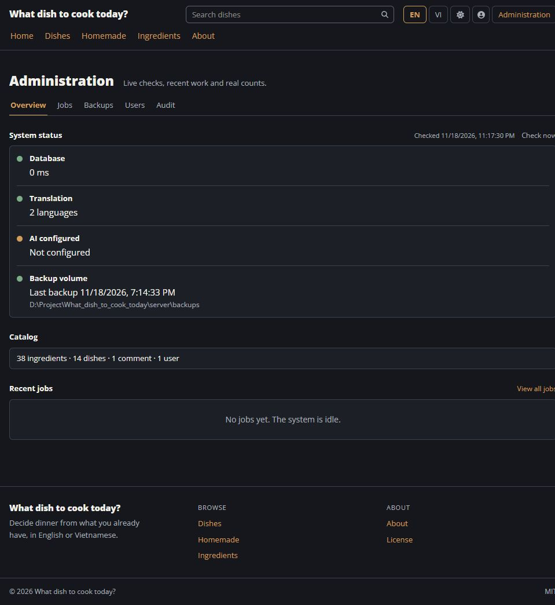
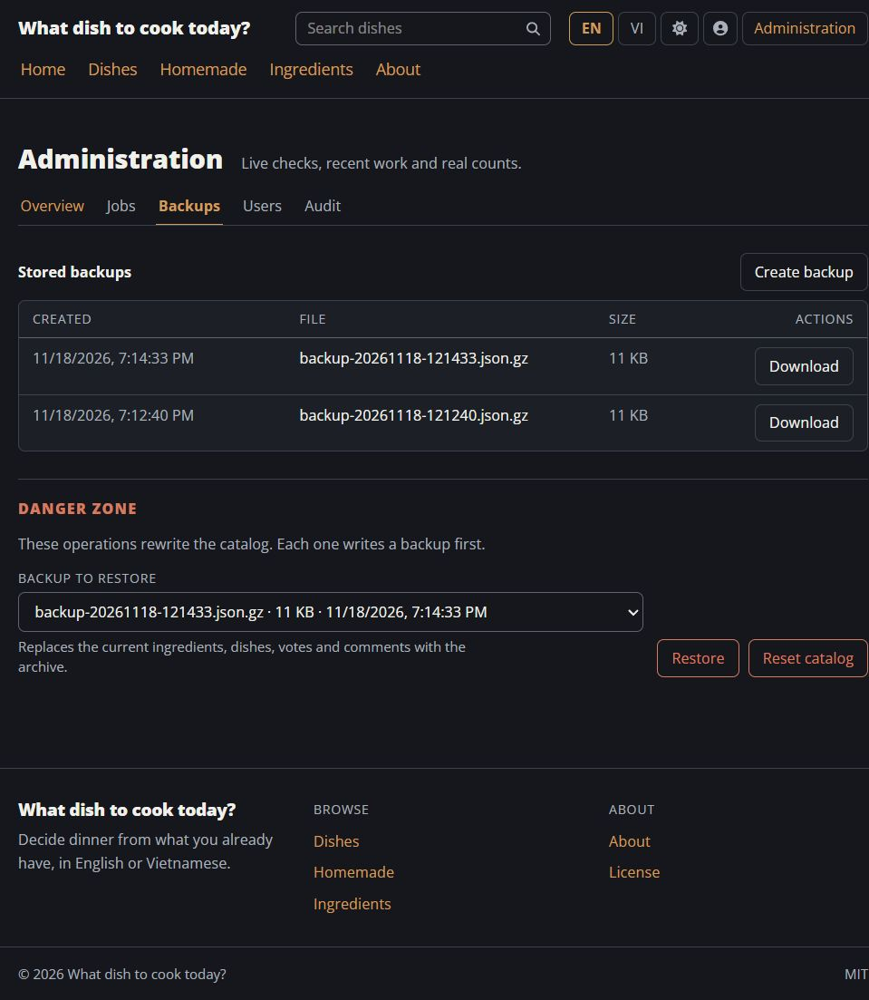

# What dish to cook today?

Pick the ingredients you have at home and the site shows dishes that use them.
Signed-in users can create dishes and ingredients and write their detail pages. Admins get a
guarded `/admin` area for jobs, backups, users and audit history.

## Admin area

The operations board is one glance: four live probes, real counts, and the most recent work. No
decorative charts, no fabricated uptime — each probe names its own fix when it fails.



Backups and the two destructive actions live together, separated from normal work. Reset and
Restore both require the word to be typed, and both write a backup first.



What the area does:

- **Jobs** are background admin operations only: `backup`, `reset`, `restore`, `recalc_best_post`.
  Each row moves queued → running → done/failed within seconds. Creating a dish is not a job.
- **Audit** is the record of who did what: admin actions plus content creation and comment
  removal (`dish.create`, `dish_post.edit`, `ingredient.create`, `comment.delete`, …), with a
  readable target, not a raw id.
- **Users** manages admins, disabled accounts and one-time temporary passwords. The last admin
  and your own role cannot be removed. Each row also has an AI switch and a daily message limit
  override.
- **AI** shows calls, latency, tokens, estimated cost and errors from `ai_call`, with a runtime
  switch and an index rebuild. It never shows prompt or reply text.

## AI assistant

A signed-in cook can open **Ask** and talk to an assistant grounded in the catalog. It has three
task modes:

- **Cook with what I have** - list ingredients and get a shortlist that links to real dishes.
- **Walk me through** - read a dish's steps, amounts and nutrition.
- **Help me use the app** - answer questions from the curated help pages.

Three capability levels gate what a tool may do:

- **Read only** (default) - search dishes, read one dish, read help. Nothing changes.
- **Prepare and confirm** - adds an ingredient-selection preview and a dish-editor draft. Both
  wait for a click; nothing is saved.
- **Act freely, bounded** - applies the reversible board selection and opens a dish. Saving a
  draft still needs confirmation.

Answers stream and cite only dishes and ingredients returned by server-side tools, so a link is
never parsed from model prose. The assistant answers in the interface language and uses
Vietnamese dish names when they exist.

Each account gets 20 completed replies per UTC day by default. Stopped, failed or provider-errored
replies do not use quota. An admin can lower or disable a user's quota, and `AI_MONTHLY_BUDGET_USD`
soft-stops new calls when the month's estimate passes it.

History is visible on the profile: dish views, "I cooked this" marks, ingredient picks and chat
messages. It personalises assistant suggestions only; the public board keeps ingredient-match
order. The user can clear history or delete the conversation. Events expire after 90 days and the
conversation after 30.

Because matching comment text can be sent to the chat provider, the panel states once: "Answers
may use public dish comments; they are sent to the AI provider." Embeddings stay local.

### Enable it

The assistant is off by default: the Ask panel is hidden and `/api/ai/*` answers 404.

1. Set `AI_ENABLED=true` in the root `.env` for Compose, or `server/.env` for a local run.
2. For the default hosted provider, set `OPENCODE_API_KEY`. For a local chat model instead, set
   `AI_PROVIDER=ollama` and `AI_MODEL` to a model the Ollama service has.
3. Embeddings use Ollama `bge-m3` in both cases. Compose starts the `ollama` service, pulls the
   model on first start and keeps it in the `ollama-models` volume. Without Compose, run Ollama
   yourself and point `OLLAMA_URL` at it.
4. Sign in, open Ask, and run **Rebuild index** on the admin AI tab once (or wait for content
   writes to enqueue per-row index jobs).

`bge-m3` needs a few GB of RAM. On a small host it competes with MongoDB and the server process.

## Parts

| Folder | What it is |
|---|---|
| `server/` | Express API, image upload, admin job queue, static host (port 3000) |
| `web_ui/` | Vue 3 client (current UI, including `/admin`) |
| `flutter_web_dev/` | Older Flutter client; its build is copied into `server/web` |
| `database_control_center/` | .NET offline console: reset, health, backup, restore (no API needed) |
| `db_control/` | .NET command line data tool |
| `catalog/` | Canonical seed data shared by the server reset and both .NET tools |
| `shared/` | C# seeding, catalog and backup code used by both .NET tools |

## Quick start with Docker Compose

```bash
cp .env.example .env        # then set a real JWT_SECRET; Compose refuses to start without it
docker compose up -d --build
docker compose ps           # wait for server "healthy"
```

- Site: `http://localhost:3000`
- Admin: `http://localhost:3000/admin`
- Health: `http://localhost:3000/api/health`, admin health: `/api/admin/health`

The stack runs `server`, `mongo`, `libretranslate` (en/vi) and `ollama` (embeddings). Volumes:
`mongo-data` (database), `backup-data` (archives at `/app/backups`), `gallery` (`public/gallery`
uploads), `translate-models` and `ollama-models`. Only port 3000 is published. Ollama's first
start downloads `bge-m3`, so the first `docker compose up` is slower; the assistant stays usable
without it through tool-only retrieval.

The first run has no account. Create one, set `ADMIN_USERNAME` to it in `.env`, then restart the
server once so boot promotes it:

```bash
curl -s -X POST http://localhost:3000/api/auth/signup \
  -H 'content-type: application/json' \
  -d '{"username":"moonshine@gmail.com","email":"moonshine@gmail.com","password":"change-me-now"}'
# .env: ADMIN_USERNAME=moonshine@gmail.com
docker compose restart server
```

`ADMIN_USERNAME` is promoted only when it is set and the account already exists. It is empty in
`.env.example`, so set it to the account you created before the restart. After that, sign in at
`/admin`; the account can change its password at `/change-password`.

If port 3000 is taken, set `SERVER_PORT=3100` in `.env` (the server keeps listening on 3000
inside the container) and add `http://localhost:3100` to `CORS_ORIGINS`. An origin that is not
listed is refused, so the site's own public origin always belongs in that list.

`docker compose down -v` removes the stack **and its data**. Use `docker compose down` to keep it.

## Try it locally in one command

No Docker, no database install: an in-memory MongoDB, the seeded catalog and the real server.

```bash
cd server
npm install
node scripts/dev-demo.mjs        # http://localhost:3000
```

Sign in with `demo` / `demo1234`. Start it with `ADMIN_USERNAME=demo` (PowerShell:
`$env:ADMIN_USERNAME='demo'; node scripts/dev-demo.mjs`) to give that account the admin role and
open `/admin`. Data lives in memory and is gone when the process stops; the memory server takes a
free port, so it never touches a local MongoDB.

## Environment

Compose reads a root `.env` (template: `.env.example`). Run the API without Docker and it reads
`server/.env` (template: `server/.env.example`) instead. Same names, different file.

| Variable | Default | Meaning |
|---|---|---|
| `JWT_SECRET` | required in Compose | Signs the session cookie. Compose refuses to start without it; a random one would lose logins on restart. |
| `MONGODB_URI` | `mongodb://localhost:27017/what_dish_to_cook_today` | Database. Compose pins `mongodb://mongo:27017/what_dish_to_cook_today`, no `directConnection`. |
| `CORS_ORIGINS` | localhost:3000/5173 | Allowed origins, comma separated. Must include the site's own public origin; any other origin is refused. |
| `ADMIN_USERNAME` | empty | Account promoted to admin on boot when it is set and the account exists. |
| `BACKUP_DIR` | `server/backups` | Where the backup job writes archives. Compose pins `/app/backups` on the `backup-data` volume. |
| `TRANSLATE_URL` | `http://localhost:5000/translate` | LibreTranslate-compatible service. Compose pins `http://libretranslate:5000/translate`. |
| `AI_ENABLED` | `false` | Turns the assistant on. While false the Ask panel is hidden and `/api/ai/*` answers 404. |
| `AI_PROVIDER` | `opencode-go` | Chat provider: `opencode-go` or `ollama`. Embeddings always use Ollama. |
| `OPENCODE_API_KEY` | empty | Key for `opencode-go`; not needed for a local Ollama chat model. |
| `AI_MODEL` | `deepseek-v4.1-flash` | Chat model name. |
| `AI_BASE_URL` | OpenCode Go inference URL | OpenAI-compatible chat endpoint; Compose pins the hosted default. |
| `EMBED_PROVIDER` | `ollama` | Local embedding provider. |
| `EMBED_MODEL` | `bge-m3` | Multilingual embedding model, pulled by the Compose `ollama` service. |
| `OLLAMA_URL` | `http://localhost:11434` | Ollama base URL. Compose pins `http://ollama:11434`. |
| `AI_DAILY_MESSAGE_LIMIT` | `20` | Completed turns per UTC day before 429; an admin can override per user. |
| `AI_MAX_TOOL_ROUNDS` | `3` | Maximum tool rounds in one answer. |
| `AI_MONTHLY_BUDGET_USD` | `10` | Soft stop on the month's estimated spend. |
| `MAINTENANCE_DISABLED` | `0` | Escape hatch for a stuck maintenance flag. |
| `TRUST_PROXY` | unset | Set to `1` behind a reverse proxy so cookies and CORS see HTTPS. Compose forwards it. |

Compose pins `MONGODB_URI`, `BACKUP_DIR` and `TRANSLATE_URL` to the service names and volumes it
creates, so `.env` values for those three are ignored. Use `server/.env` when you run the API
without Compose.

`CORS_ORIGINS` needs the site's own origin because the built Vue assets carry `crossorigin` and
send an `Origin` header even from the same host. Only listed origins are accepted; the `Host`
header is caller-controlled and is never used to grant access.

## Migrating an existing deployment

The `database_control_center` worker and the `/worker` WebSocket endpoint are gone. Admin
operations (reset, backup, restore, recalc best post) now run inside the API server, one at a
time, through the `admin_job` queue.

1. Remove `DATABASE_WORKER_EXE` and `WORKER_WS_URL` from the environment. Nothing reads them.
2. Stop the old Windows worker window. It can no longer connect; use the offline console in
   `database_control_center/` if you need a desktop tool.
3. Old `database_worker_job` rows are not read. Delete that collection after a backup.
4. Add `JWT_SECRET`, `ADMIN_USERNAME` and `BACKUP_DIR`, and set `CORS_ORIGINS` to the site's own
   origin.
5. If the container replaces a local install, copy `server/public/gallery` into the `gallery`
   volume and `server/backups` into `backup-data`, or restore from an archive instead.

A backup made by `db_control` restores through `/admin`, and a server backup restores through
`db_control restore`, because both use the same gzip JSON contract.

## Run the API without Docker

Requires Node.js 22+ and MongoDB on `localhost:27017`.

```bash
cd server
npm install
cp .env.example .env        # then set a real JWT_SECRET
npm start                   # http://localhost:3000
```

Optional translation for the editor: run a LibreTranslate-compatible service and point
`TRANSLATE_URL` at it. For example:

```bash
docker run -d --name libretranslate -p 5000:5000 \
  -e LT_LOAD_ONLY=en,vi -e LT_UPDATE_MODELS=false \
  libretranslate/libretranslate:latest
# server/.env: TRANSLATE_URL = http://localhost:5000/translate
```

Without it the editor's auto-translate toggle reports that translation is unavailable and you
enter both languages yourself. A failure keeps what you typed and says whether the service is not
configured or simply not answering; saving is never blocked.

## Run the Vue client for development

```bash
cd web_ui
npm install
npm run dev                 # http://localhost:5173
```

The API base URL defaults to `http://localhost:3000/`; set `VITE_SERVER_URL` to change it.
The dev server does not serve `/public/i18n/*.json`, so interface keys show raw in `npm run dev`;
the build served by Express is fine.

## Run the Flutter client

The assistant is Vue-only in this release. Flutter signs in, browses and records cooking
history (`dish_viewed`, `dish_cooked`, `ingredient_picked`), so its users still feed the same
personalisation, but it has no Ask panel and no AI profile controls. Porting it means a chat sheet,
an SSE reader, capability and quota controls, and the same citation linking — tracked in
[docs/KNOWN_ISSUES.md](docs/KNOWN_ISSUES.md).

```bash
cd flutter_web_dev
flutter pub get
flutter test
flutter build web
# copy build/web/* into server/web/ to serve it at http://localhost:3000/flutter
```

## Data and backups

The site needs users, roles and seeded content. `server/config/database/connection.js` defines
the collections; `docs/DATA_MODEL.md` explains the fields. `catalog/*.json` is the canonical
catalog: the admin reset, `db_control init` and the Windows console all produce the same 38
ingredients and 13 dishes with nutrition, amounts and images.

The admin reset writes a backup first, then rebuilds the six catalog collections and recreates
their unique indexes. Users, roles, audit rows, jobs and settings survive a reset.

Server backups land in `BACKUP_DIR` (`server/backups` locally, the `backup-data` volume in
Compose). Each is `backup-YYYYMMDD-HHmmss.json.gz`, the newest 10 are kept, and the archive
includes password hashes for `user`, so treat it as sensitive. A restore replaces the catalog
only.

`db_control backup` writes the same `backup-YYYYMMDD-HHmmss.json.gz` name (UTC) in the current
directory unless `--out` names another file, and the Windows console offers that name too. The
admin page lists only that pattern inside `BACKUP_DIR`, so copy an archive made elsewhere into
`BACKUP_DIR` (`server/backups` locally, `/app/backups` in Compose) before restoring it from
`/admin`; an explicit `--out` keeps the name the operator chose.

## Offline repair kit

`db_control` is the command line repair kit. It needs only MongoDB; the API server may be down.
The Windows console (`database_control_center`) offers the same operations in tabs: Connection,
Health, Operations and Log. Every destructive action there writes a backup first.

```bash
dotnet build db_control/db_control/db_control.csproj
dotnet run --project db_control/db_control -- health
dotnet run --project db_control/db_control -- init --yes
dotnet run --project db_control/db_control -- backup
dotnet run --project db_control/db_control -- restore --file backup-20261118-090232.json.gz --yes
dotnet run --project db_control/db_control -- recalc-best-post <ingredient_id>
```

Global options: `--uri` (else `MONGODB_URI`, then `mongodb://localhost:27017`), `--db`
(default `what_dish_to_cook_today`), `--json`, `--yes`, `--help`, `--version`.
Exit codes are 0 success, 1 failure and 2 usage error. `init` and `restore` are destructive: pass
`--yes` or type `RESET` / `RESTORE` in a terminal. Without a terminal and without `--yes` they
refuse with exit code 2.

The offline self-check builds and runs without a server or database:

```bash
dotnet run --project db_seed_tests
```

Package the console for a machine without the .NET SDK:

```bash
dotnet publish database_control_center/database_control_center/database_control_center.csproj \
  -c Release -r win-x64 --self-contained
```

## Documentation

- [AGENTS.md](AGENTS.md) — repository map for new contributors and AI agents
- [CONTRIBUTING.md](CONTRIBUTING.md) — how to build, test and commit
- [docs/ARCHITECTURE.md](docs/ARCHITECTURE.md) — components, request flow, Compose and admin operations
- [docs/API.md](docs/API.md) — every endpoint with request and response shapes
- [docs/DATA_MODEL.md](docs/DATA_MODEL.md) — collections, invariants, seeding, backups
- [docs/KNOWN_ISSUES.md](docs/KNOWN_ISSUES.md) — what is still broken or unfinished
- [PRODUCT.md](PRODUCT.md) — product brief and user roles

## License

MIT. See [LICENSE](LICENSE).
